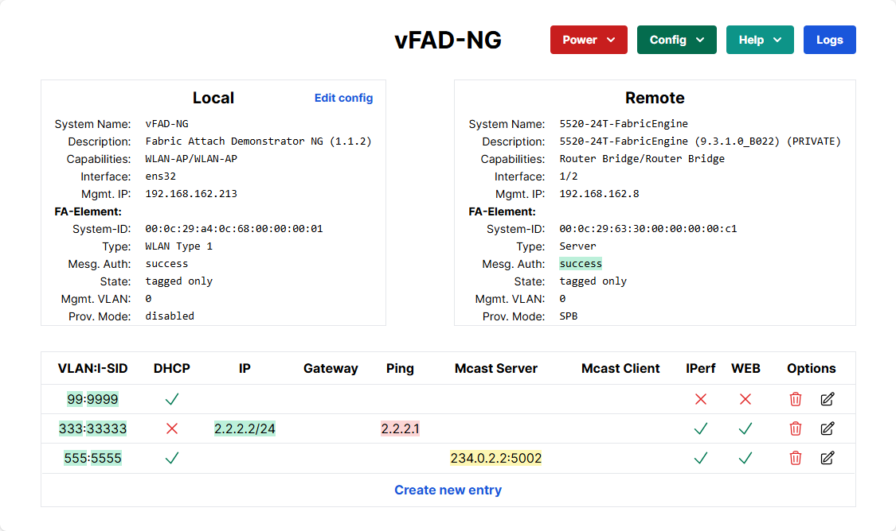

# Fabric-Attach-Demonstrator (vFAD)

Automated Service Attachment for Enterprises

The Virtual Fabric Attach Demonstrator is a collection of Python scripts that simulate an LLDP daemon with the Auto Attach extension. A WEB-UI presents the status and allows defining LLDP/AA endpoints such as Access Point, Camera, or IP-Phone. Also, it is possible to set up VLAN/I-SID bindings, which will signal to the network device. The test tools monitor the status of the binding, the default gateway, and optional Ping targets. The multicast client and server allow for the delivery of multicast streams across the network. An iPerf server can also be activated as a test endpoint.

## Installation
Use Debian 12 or Ubuntu 22.04 as basement. A non-graphical installation is sufficient. Pull the GitHub repository to you like this
<b> 
git clone https://github.com/extremenetworks/Fabric-Attach
</b>

and change into the right directory for installation
<b> 
cd Fabric-Attach/Fabric-Attach-Demonstrator/
</b>

The installer must be called with root access rights, like this
<b> 
sudo bash ./vFAD-NG_installer.sh
</b>

After the installation is successful complete; an OS reboot is recommended. After the reboot, you can access the vFAD-NG via the WEB-UI
<b> 
http://\<your-ip-adress\>/
</b>  

 
Please read the user guide for more details [vFAD-NG user guide](vFAD-NG_UserGuide.pdf)
 

## License
Copyright© 2025, Extreme Networks
All rights reserved.

Redistribution and use in source and binary forms, with or without modification,
are permitted provided that the following conditions are met:

1. Redistributions of source code must retain the above copyright notice, this
list of conditions and the following disclaimer.

2. Redistributions in binary form must reproduce the above copyright notice,
this list of conditions and the following disclaimer in the documentation
and/or other materials provided with the distribution.

THIS SOFTWARE IS PROVIDED BY THE COPYRIGHT HOLDERS AND CONTRIBUTORS "AS IS" AND
ANY EXPRESS OR IMPLIED WARRANTIES, INCLUDING, BUT NOT LIMITED TO, THE IMPLIED
WARRANTIES OF MERCHANTABILITY AND FITNESS FOR A PARTICULAR PURPOSE ARE
DISCLAIMED. IN NO EVENT SHALL THE COPYRIGHT HOLDER OR CONTRIBUTORS BE LIABLE
FOR ANY DIRECT, INDIRECT, INCIDENTAL, SPECIAL, EXEMPLARY, OR CONSEQUENTIAL
DAMAGES (INCLUDING, BUT NOT LIMITED TO, PROCUREMENT OF SUBSTITUTE GOODS OR
SERVICES; LOSS OF USE, DATA, OR PROFITS; OR BUSINESS INTERRUPTION) HOWEVER
CAUSED AND ON ANY THEORY OF LIABILITY, WHETHER IN CONTRACT, STRICT LIABILITY,
OR TORT (INCLUDING NEGLIGENCE OR OTHERWISE) ARISING IN ANY WAY OUT OF THE USE
OF THIS SOFTWARE, EVEN IF ADVISED OF THE POSSIBILITY OF SUCH DAMAGE.

## Support
The software is provided as is and Extreme Networks has no obligation to provide
maintenance, support, updates, enhancements or modifications.
Any support provided by Extreme Networks is at its sole discretion.

Issues and/or bug fixes may be reported on [The Hub](https://community.extremenetworks.com/).

